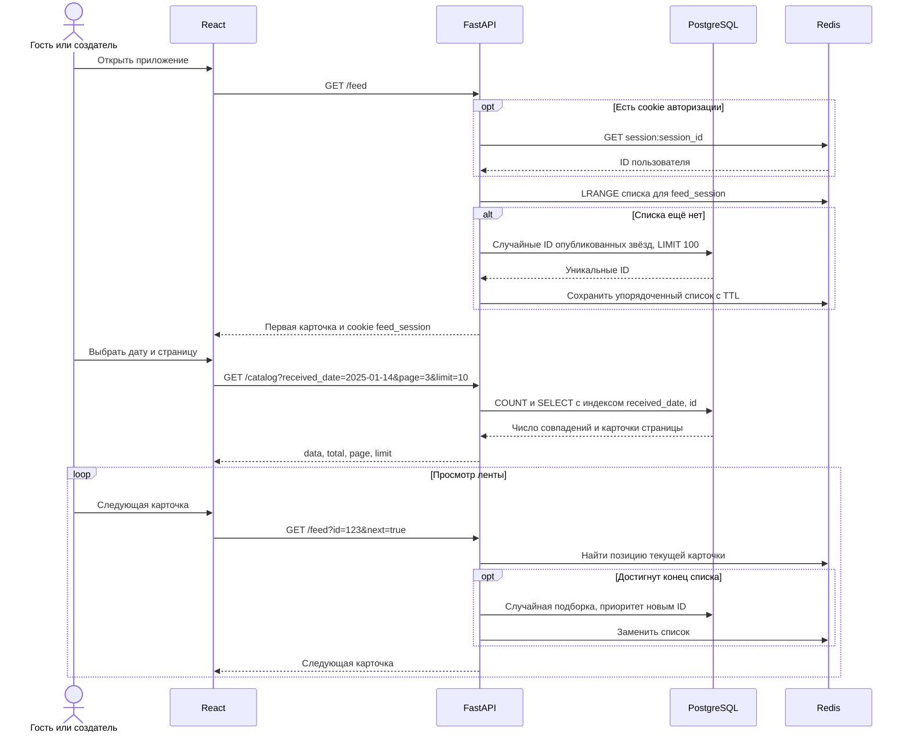

# Дополнительное задание. Каталог и лента звёздных систем

Для нового гостя ключ имеет вид `feed:guest:<feed_session>`. Для вошедшего пользователя ключ включает его ID. Индекс списка в Redis соответствует позиции карточки, начиная с нуля.
